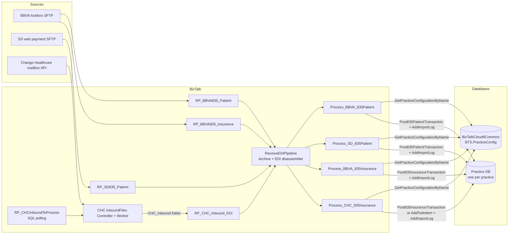

# 835 payment processing: end to end

This document describes the patient and insurance payment flows (lockbox and 835) in detail. It covers the receive side, the maps, the orchestrations, the stored procedure calls, and the logs. Most facts come from the source files in this repository. A statement that comes from inference has the label **(inferred)**. Some facts come from the documents in the `references` folder. Those facts name their source. The section [Reference documents compared with the code](#reference-documents-compared-with-the-code) lists where the references and the code do not agree.

Related documents:

- [03-replacement-guide.md](03-replacement-guide.md) tells you what a replacement application must do.
- [04-data-contracts.md](04-data-contracts.md) lists every parameter and field.
- [05-known-issues-and-open-questions.md](05-known-issues-and-open-questions.md) lists defects, gaps, and unknowns.
- The readable map dumps are in [../map-summaries](../map-summaries). Each dump lists every link, functoid, and inline script of one map.
- The graph nodes for these flows start at `flow:*` in [../graph/index.md](../graph/index.md).

## Summary of the five flows

| Flow                            | Source                                 | Entry point            | Orchestration               | Practice key                | Stored procedures (practice DB unless noted)                                                           | Graph node                         |
| ------------------------------- | -------------------------------------- | ---------------------- | --------------------------- | --------------------------- | ------------------------------------------------------------------------------------------------------ | ---------------------------------- |
| A. BBVA patient lockbox         | BBVA / Navigant lockbox SFTP           | `RP_BBVA835_Patient`   | `Process_BBVA_835Patient`   | Folder name                 | `BTS.Post835PatientTransaction`, `BTS.AddImportLog`                                                    | `flow:BBVA-835-Patient-Lockbox`    |
| B. SD web patient payment       | Smile Doctors web payment SFTP         | `RP_SD835_Patient`     | `Process_SD_835Patient`     | Folder name (`SD-<REGION>`) | `BTS.Post835PatientTransaction`, `BTS.AddImportLog`                                                    | `flow:SD-835-Web-Patient-Payment`  |
| C. BBVA insurance lockbox       | BBVA / Navigant lockbox SFTP           | `RP_BBVA835_Insurance` | `Process_BBVA_835Insurance` | Folder name                 | `BTS.Post835InsuranceTransaction`, `BTS.AddImportLog`                                                  | `flow:BBVA-835-Insurance-Lockbox`  |
| D. Change Healthcare ERA 835    | Change Healthcare (Emdeon) mailbox API | `RP_CHC_Inbound_EDI`   | `Process_CHC_835Insurance`  | File name prefix            | `BTS.Post835InsuranceTransaction`, `BTS.AddTodoItem`, `BTS.AddImportLog`, central `BTS.CreateLogEntry` | `flow:CHC-835-Insurance-ERA`       |
| E. CHC 835 pass-through to BBVA | Change Healthcare file folder          | `RP_CHC835ToBBVA`      | `Process_CHC_835_To_BBVA`   | None (payee ID lookup)      | Central `BTS.GetApplicationLookupValues`                                                               | `flow:CHC-835-To-BBVA-Passthrough` |

Every posting flow uses the central lookup `BTS.GetPracticeConfigurationByName` in the `BizTalkCloud9Common` database.



## Shared receive behavior

All 835 receive locations use the pipeline `Cloud9.BizTalk.X12.Pipelines.ReceiveEDIPipeline` ([ReceiveEDIPipeline.btp](../../Cloud9.BizTalk/Cloud9.BizTalk.X12/Pipelines/ReceiveEDIPipeline.btp)).

1. **Archive component** (decode stage). Class `Cloud9.BizTalk.Shared.Components.Archive.Archive` ([Archive.cs](../../Cloud9.BizTalk/Cloud9.BizTalk.Shared.Components.Archive/Archive.cs)). The binding sets `FilePath` to `<receive folder>\Archive` and `FileName` to `%FileReceivedFileName%%FileReceivedFileExtension%`. The component writes a copy of the raw file before parsing. `Overwrite` is true.
2. **EDI disassembler** (disassemble stage). `EdiDataValidation` is true. `XmlSchemaValidation` is false. `PreserveInterchange` is false. Thus BizTalk publishes **one message for each ST/SE transaction set**. Each orchestration instance processes one transaction set, not one file.
3. The disassembler picks the schema namespace from the party agreement that matches the ISA sender and receiver IDs. See the table below. The orchestrations subscribe by message type `namespace#X12_00501_835`.

| Agreement (in [PartyCollection.xml](../../Cloud9.BizTalk/Configuration/PartyCollection.xml)) | Sender identity                                                 | Receiver identity                         | Schema namespace                                                 | Used by       |
| -------------------------------------------------------------------------------------------- | --------------------------------------------------------------- | ----------------------------------------- | ---------------------------------------------------------------- | ------------- |
| `BBVA_To_SmileDoctors`                                                                       | ZZ `BBVANAV`                                                    | ZZ `SMILE DOCTORS`                        | `http://schemas.microsoft.com/BizTalk/EDI/X12/2006/BBVA`         | Flows A and C |
| `SmileDoctors_To_Cloud9`                                                                     | ZZ `SMILE DOCTORS`                                              | ZZ `CLOUD9`                               | `http://schemas.microsoft.com/BizTalk/EDI/X12/2006/SmileDoctors` | Flow B        |
| `ChangeHealthcare_Cloud9` (and related CHC agreements)                                       | Change Healthcare IDs (`0135WCH00`, `WEBMDDENTAL`, `061267267`) | CLOUD9 IDs (`271836984`, `CLOUD9`, `462`) | `http://schemas.microsoft.com/BizTalk/EDI/X12/2006/CHC`          | Flows D and E |

The exact direction of each CHC identity inside each agreement is not confirmed. Read the agreement XML before you rely on it.

### Receive locations and folders

The binding file is [Cloud9.EDI.Deployment/PortBindingsMaster.xml](../../Cloud9.BizTalk/Cloud9.EDI.Deployment/PortBindingsMaster.xml). The `${...}` values come from [SettingsFileGenerator.xml](../../Cloud9.BizTalk/Cloud9.EDI.Deployment/SettingsFileGenerator.xml). The graph has every setting as a `setting:*` node with values for each environment. Secrets are redacted in the graph.

| Receive port           | Location pattern                                                                                      | Transport         | Notes                                                                                                                                                       |
| ---------------------- | ----------------------------------------------------------------------------------------------------- | ----------------- | ----------------------------------------------------------------------------------------------------------------------------------------------------------- |
| `RP_BBVA835_Patient`   | `${BBVA_835_PATIENT_FILE_FOLDER}\<REGION>\*.*`                                                        | FILE, poll 60 s   | One FILE and one SFTP location for each region                                                                                                              |
| `RP_BBVA835_Patient`   | `sftp://${BBVA_SFTP_HOST}${BBVA_835_PATIENT_FTP_FOLDER}/<REGION>/*.*`                                 | SFTP, poll 15 min | Daily schedule, Eastern time, window 02:00 to 05:00                                                                                                         |
| `RP_BBVA835_Insurance` | `${BBVA_835_INSURANCE_FILE_FOLDER}\<REGION>\*.*` and SFTP `${BBVA_835_INSURANCE_FTP_FOLDER}/<REGION>` | FILE and SFTP     | Same pattern as patient                                                                                                                                     |
| `RP_SD835_Patient`     | `${SD_835_WEB_FILE_FOLDER}\SD-<REGION>\*.*` and SFTP `${SD_835_WEB_FTP_FOLDER}/SD-<REGION>`           | FILE and SFTP     | Folder names keep the `SD-` prefix. Exception: the PRACTICASMILEDOCTORS locations use the folder `SMILEDOCTORS` (no prefix). `SD-MIDWEST2` is defined twice |
| `RP_CHC_Inbound_EDI`   | `${ADDR_FILE_ROOT}\CHC_Inbound\*.*`                                                                   | FILE              | Shared by 835, 277 and 277CA. Archive goes to `${CH_835_INSURANCE_FILE_FOLDER}\Archive`                                                                     |
| `RP_CHC835ToBBVA`      | `${CH_835_TO_BBVA_FILE_FOLDER}\*.*`                                                                   | FILE              | SFTP location exists but is disabled                                                                                                                        |

Regions in the binding (22): GULFCOAST, GULFCOAST2, MIDATLANTIC, HOUSTONMETRO, ATLANTAMETRO, ATLANTAMETRO2, CENTRALPLAINS, DALLASMETRO, DALLASMETRO2, DALLASMETRO3, DNORTHO, INDIANA, KNOXVILLEMETRO, MOUNTAINCENTRAL, PRACTICASMILEDOCTORS, SOUTHEAST, SOUTHEAST2, SOUTHWEST, AUSTINMETRO, MIDWEST, MIDWEST2, SPILLERS.

SFTP locations sit between `${DEV_ENV_START}` and `${DEV_ENV_STOP}` markers. The settings generator can remove that block for some environments. Many locations have `<Enable>false</Enable>` in the master file. The live state on the BizTalk server can differ. Confirm the live state before cut-over.

The discovery session of 2026-10-14 reported these operation facts:

- BizTalk polls the SFTP location about every 15 minutes.
- Files arrive through the whole day. Most files arrive near 06:00 Eastern.
- The legacy configuration keeps 21 original Cloud9-instance folders. Only about 9 folders are in use after the practice consolidation.
- Failed items can need a service restart, a file restore from the archive, or a manual reprocess.

The 02:00 to 05:00 window in the master binding does not agree with a 06:00 peak. The binding has 22 regions, not 21. Confirm the live schedule and the active folders on the server. See document 05, items C8 and C9.

### Practice resolution

Each posting flow must find the practice database. BizTalk uses the central table `BTS.PracticeConfig` ([PracticeConfig.sql](../../Cloud9.BizTalk.Database/Cloud9.BizTalk.Central.Database/BTS/Tables/PracticeConfig.sql)).

1. The flow gets a practice name.
   - Flows A, B, C: the name of the folder that contains the file. The code takes `BTS.InboundTransportLocation`, removes the text after the last `\` (FILE) or `/` (SFTP or FTP), and keeps the last path segment. For `...\Patient\GULFCOAST\*.*` the name is `GULFCOAST`. For `.../SD-GULFCOAST/*.*` the name is `SD-GULFCOAST`.
   - Flow D: the text of `FILE.ReceivedFileName` after the last `\` and before the first `_`. The CHC mailbox worker writes file names as `<pcName>_<GUID>.edi`.
2. The flow calls `BTS.GetPracticeConfigurationByName(@pcName NVARCHAR(50))`. The procedure returns `pcGUID`, `pcInstanceAddress`, `pcInstanceConnectionString` for the row where `pcName = @pcName`. The procedure does not filter on `pcsStatusID`.
3. The flow uses `pcInstanceAddress` as the WCF-SQL address of the dynamic send port. The value has the form `mssql://<server>/<instance>/<database>?` **(inferred from the adapter type)**.

Flows A, B and C do not check for an empty result. If no row matches, the send to an empty address fails, the exception goes to the event log, and nothing is posted. Flow D checks for an empty address for each claim (see flow D).

## Flow A: BBVA patient lockbox 835

Source: [Process_BBVA_835Patient.odx](../../Cloud9.BizTalk/Cloud9.BizTalk.X12/Orchestrations/Process_BBVA_835Patient.odx) (XLANG code starts at line 556).

### Steps

1. Activate on `ReceiveBBVA835PatientPort`. The logical port binds to `RP_BBVA835_Patient`. The message type is `BBVA835_MMT` (schema `Cloud9.BizTalk.X12.Schemas.BBVA_X12_00501_835`).
2. Get the practice name from the folder. Call `GetPracticeConfigurationByName` through the static send port `SP_BizTalkCloud9Common_WCF`.
3. Transform the 835 with `BBVA_835Patient_To_ClaimPaymentBatchCanonical`. The result has one `ClaimPayment` for each 2100 (CLP) loop.
4. For each `ClaimPayment` (positional XPath `//*[local-name()='ClaimPayment'][n]`):
   1. Transform with `ClaimPaymentCanonical_To_Post835PatientTransaction`.
   2. Set `lbcLockboxCodeType` to `PATIENT`. The map writes the placeholder `setme` first.
   3. Send to the dynamic port with `WCF.Action = TypedProcedure/BTS/Post835PatientTransaction`, `useAmbientTransaction=false`, `EnableTransaction=false`, `RetryCount=0`.
   4. Read `ErrorCount` and `ResponseMessage` from the first result set.
   5. If `ErrorCount != "0"`, write the message to the event log `BizTalk.Process_BBVA_835Patient`. Set log level 0 and state `Failed`. Else set log level 2 and state `Finished`. The log message is `ResponseMessage` in both cases.
   6. Call `BTS.AddImportLog` in the same practice database. See [ImportLog rows](#importlog-rows).
5. Catch `System.Exception`: write `ex.ToString()` to the event log only. No ImportLog row, no suspend. The remaining payments in the transaction set are not processed.

### Map: BBVA 835 to canonical (patient)

Source: [BBVA_835Patient_To_ClaimPaymentBatchCanonical.btm](../../Cloud9.BizTalk/Cloud9.BizTalk.X12/Maps/BBVA_835Patient_To_ClaimPaymentBatchCanonical.btm). Dump: [map summary](../map-summaries/BBVA_835Patient_To_ClaimPaymentBatchCanonical.txt).

| Canonical field                                               | Source in the 835                             | Logic                                                                                                   |
| ------------------------------------------------------------- | --------------------------------------------- | ------------------------------------------------------------------------------------------------------- |
| (record) `ClaimPayment`                                       | Loop 2100 (`TS835_2000_Loop/TS835_2100_Loop`) | One record for each CLP                                                                                 |
| `PaymentMethodCode`                                           | BPR04                                         | Copy                                                                                                    |
| `SenderDFIIdentifier`                                         | BPR07                                         | Copy                                                                                                    |
| `PatientControlNumber`                                        | CLP01                                         | Copy                                                                                                    |
| `TotalActualProviderPaymentAmount`                            | CLP04                                         | Copy                                                                                                    |
| `PayerClaimControlNumber`                                     | CLP07                                         | Copy                                                                                                    |
| `PatientIdentifier`                                           | NM1*QC NM109                                  | Copy. Contains the Cloud9 `patGUID`                                                                     |
| `SubscriberIdentifier`                                        | NM1*IL NM109                                  | Copy. Contains the responsible party `ppGUID` (PersonPerson)                                            |
| `pipGUID`                                                     | NM1*IL NM109                                  | Copy (not used by the patient posting map)                                                              |
| `ProviderIdentifier`, `ProviderLastName`, `ProviderFirstName` | NM1*82 NM109, NM103, NM104                    | Copy (not used later)                                                                                   |
| `PaymentDepositDate`                                          | DTM02 (header DTM, production date)           | Copy                                                                                                    |
| `CheckorEFTTraceNumber`                                       | TRN02                                         | Copy                                                                                                    |
| `ReferenceIdentifier`                                         | TRN02                                         | Copy                                                                                                    |
| `CheckDate`                                                   | BPR16                                         | Copy                                                                                                    |
| `LockboxNumber`                                               | Header REF*LB REF02                           | Copy                                                                                                    |
| `PaymentIdentifier`                                           | 2100 REF REF02 where REF01 = `F8`             | Looping plus value mapping                                                                              |
| `TransactionNote`                                             | DTM02, BPR16, REF*LB                          | `"Deposit Date: " + DTM02 + ", Check Date: " + BPR16 + ", Lockbox: " + GetLockboxNumber(REF*LB, DTM02)` |
| `CheckIssueorEFTEffectiveDate`, `PaymentPostedDate`           | None                                          | Current date and time of the map run (functoid FID 125, inferred)                                       |

`GetLockboxNumber(lockboxCode, checkDate)` removes the `checkDate` text from the lockbox code and removes one trailing `_`.

```csharp
public string GetLockboxNumber(string lockboxCode, string checkDate)
{
    if (lockboxCode.Contains(checkDate)) lockboxCode = lockboxCode.Replace(checkDate, System.String.Empty);
    if (lockboxCode.EndsWith("_")) lockboxCode = lockboxCode.Substring(0, lockboxCode.Length - 1);
    return lockboxCode;
}
```

The BBVA patient mapping spec v1 has a sample. The header `REF*LB*DAL-674462_3_20200205` and `DTM*405*20200205` give the lockbox `DAL-674462_3`.

The production samples of 2026 (`references/SampleInputFiles/BBVA_835/Patient/GULFCOAST`, 7 files) use a different form: `<n>_<AAA>-<999999>_<yyyyMMdd>`, where `<n>` has 1 to 3 digits. In all 7 files the date part equals DTM*405, so `GetLockboxNumber` returns `<n>_<AAA>-<999999>`.

### Production samples (structure only)

The 7 patient samples (2026-08-06 to 2026-10-09, region GULFCOAST) show these facts. The files contain PHI. Do not copy them into a git repository or a ticket.

- File name: `SDOC_<yyyyMMdd>_<REGION>[_PATPAY]_<2 characters>.835`.
- Envelope: element separator `*`, segment terminator `~`, ISA11 `^`, ISA14 `0`, ISA15 `P`, GS08 `005010X221A1`.
- Each file has one ST and one CLP. No file has PLB, CAS, or SVC. Each file has a TS3 segment, which no map uses.
- Header REF qualifiers: `2U`, `LB`, `TJ`. Loop 2100 REF qualifiers: `F8` (shape `AAA99999999`, becomes `PaymentIdentifier`) and `G2` (not mapped).
- BPR04 is `CHK` (4 files, BPR01 `C`) or `PCC` (3 files, BPR01 `U`). The mapping spec lists only `CHK`, `CAS`, and `CCC`. `lbcLockboxCode` receives the BPR04 value as is.
- BPR16 (check date) and DTM*405 (deposit date) are different in 5 of 7 files.
- CLP01 has the shape `AAA999999`. CLP07 is empty.
- In 5 files, NM1*QC and NM1*IL both carry a GUID in NM109. In 2 `PCC` files, NM1*QC has no NM109 and no NM1*IL segment exists. For these files, `patGUID` and `ppGUID` are empty.

### Production ImportLog results for the samples

Wes supplied the `dbo.ImportLog` rows of the 7 sample files (2026-10-20). They show these facts:

- The 5 files with GUIDs: level 2, state `Finished`, message ends with `:: Success`.
- The 2 `PCC` files without GUIDs: level 0, state `Failed`, message ends with `:: Patient record not found for patGUID NULL; PersonPerson record not found for ppGUID NULL;`. Thus the procedure received NULL (not an empty string) and returned `ErrorCount <> 0`. BizTalk did not retry. The procedure body (read on C9-T `TestC9`, 2026-10-20) writes an `UnmappedTransaction` row with the error text for each failed payment, so these 2 payments are in `UnmappedTransaction`.
- The procedure builds the `ResponseMessage`. See [04-data-contracts.md](04-data-contracts.md) for its format.
- The "Check Date" and "Deposit Date" in the message equal the processing date, not BPR16 or DTM*405. This confirms that the deployed map sends the processing time (D9, D16).
- `ilFileName` is the file name only (SFTP pickup). `ilExternalReference` is REF*F8 (`EOB` and 8 digits). `CREATEDBY` is NULL.
- BizTalk processed each file 1 to 3 days after the date in its name. The processing times spread from about 06:40 to 17:50 (server time). This does not agree with the 02:00 to 05:00 window in the master binding (C8).

### Map: canonical to Post835PatientTransaction (lockbox)

Source: [ClaimPaymentCanonical_To_Post835PatientTransaction.btm](../../Cloud9.BizTalk/Cloud9.BizTalk.X12/Maps/ClaimPaymentCanonical_To_Post835PatientTransaction.btm). Dump: [map summary](../map-summaries/ClaimPaymentCanonical_To_Post835PatientTransaction.txt).

| Parameter                                                 | Value                                                        |
| --------------------------------------------------------- | ------------------------------------------------------------ |
| `patGUID`                                                 | `PatientIdentifier` (NM1*QC NM109)                           |
| `ppGUID`                                                  | `SubscriberIdentifier` (NM1*IL NM109)                        |
| `transRouting`                                            | `SenderDFIIdentifier` (BPR07)                                |
| `lbcLockboxCode`                                          | `PaymentMethodCode` (BPR04)                                  |
| `lbcLockboxCodeType`                                      | `setme`, then the orchestration sets `PATIENT`               |
| `transReference`                                          | `ReferenceIdentifier` (TRN02)                                |
| `transCheckNumber`                                        | `CheckorEFTTraceNumber` (TRN02)                              |
| `PaymentIdentifier`                                       | `PaymentIdentifier` (REF*F8)                                 |
| `transNote`                                               | `TransactionNote`                                            |
| `transAmount`, `transDueNowAmount`, `transTotalDueAmount` | `TotalActualProviderPaymentAmount * -1` (CLP04 negated)      |
| `transProductionAmount`, `transClaimAmount`               | `'0'`                                                        |
| `transIsGroup`                                            | `'0'`                                                        |
| `transStatus`                                             | `'N'`                                                        |
| `transGUID`                                               | `Guid.NewGuid()`                                             |
| `transDateTime`                                           | `FormatDate(CheckIssueorEFTEffectiveDate)` = processing time |
| `transDateTimePosted`                                     | `FormatDateTimePosted(PaymentPostedDate)` = processing time  |

`FormatDate` returns `yyyy-MM-dd` for an 8-character `yyyyMMdd` input. Else it parses the input and returns `yyyy-MM-ddTHH:mm:ss`. These functoids also reference `DateFormatConversion.ConvertHL7DateToSQLDatetimeWithoutOffset`, but the map's script precedence puts inline C# first. Thus the inline C# runs.

### Verification scripts

[835BBVAPatientPaymentLockbox](../../Cloud9.BizTalk.Scripts/835BBVAPatientPaymentLockbox) has helper queries for testers.

- `GetLockboxPaymentType.sql` checks `BTS.PaymentType` (practice DB) and `TransactionType` for code `LBOXPERCMO`. The practice must have this transaction type.
- `GetTransactionsPatientPayment.sql` finds posted rows in `[Transaction]` where `transNote LIKE '%Lockbox%'`.
- `GetInfoToReplaceOn835File.sql` shows how test files are built: NM1*QC NM109 = `patGUID`, NM1*IL NM109 = `PersonPerson.ppGUID` of the financially responsible person.
- `GetImportLogsPatientPaymentSuccess.sql` and `...Failed.sql` read `ImportLog` by `ilProcess`.

## Flow B: SD web patient payment 835

Source: [Process_SD_835Patient.odx](../../Cloud9.BizTalk/Cloud9.BizTalk.X12/Orchestrations/Process_SD_835Patient.odx) (XLANG code starts at line 552).

The structure is the same as flow A. The differences:

1. The schema is `SD_X12_00501_835` (namespace `.../SmileDoctors`). Its element names are generic (`BPR/BPR04`, `LXLoop1/CLPLoop1/REF_3`).
2. The practice name keeps the `SD-` prefix of the folder (for example `SD-GULFCOAST`). The SD web location for PRACTICASMILEDOCTORS uses the folder `SMILEDOCTORS`, so its practice name is `SMILEDOCTORS`.
3. The orchestration also computes the file name and calls `XLangMessageHelpers.GetReceiveLocationName`. Neither value is used later.
4. The canonical map runs before the practice lookup.
5. The posting map is `ClaimPaymentCanonical_To_Post835PatientTransactionWeb`. `lbcLockboxCodeType` is `WEB`.
6. On success the ImportLog message is the constant `Processed successfully`. `ilExternalReference` is not sent.
7. The event log source text is `BizTalk.Process_BBVA_835Patient` (copy-paste in the source).

### Map: SD 835 to canonical

Source: [SD_835WebPayment_To_ClaimPaymentBatchCanonical.btm](../../Cloud9.BizTalk/Cloud9.BizTalk.X12/Maps/SD_835WebPayment_To_ClaimPaymentBatchCanonical.btm). Dump: [map summary](../map-summaries/SD_835WebPayment_To_ClaimPaymentBatchCanonical.txt).

BPR04 controls the payment type: `CCC` = credit card, `ACH` = ACH, `REV` = web ACH return.

| Canonical field                                     | Source                   | Logic                                   |
| --------------------------------------------------- | ------------------------ | --------------------------------------- |
| (record) `ClaimPayment`                             | `LXLoop1/CLPLoop1`       | One record for each CLP                 |
| `PaymentMethodCode`                                 | BPR04                    | Copy                                    |
| `SenderDFIIdentifier`                               | BPR07                    | Copy                                    |
| `CheckDate`                                         | BPR16                    | Copy                                    |
| `CheckorEFTTraceNumber`, `OpenEdgeTransactionID`    | TRN02                    | Copy                                    |
| `ClaimIdentifier`                                   | TRN04                    | Copy                                    |
| `PaymentDepositDate`                                | DTM02                    | Copy                                    |
| `LockboxNumber`                                     | Header REF02             | Copy                                    |
| `TotalActualProviderPaymentAmount`                  | CLP04                    | Copy                                    |
| `PatientControlNumber`                              | CLP01                    | Copy                                    |
| `PayerClaimControlNumber`                           | CLP07                    | Copy                                    |
| `PatientIdentifier`                                 | NM109                    | Copy (first NM1 in the loop)            |
| `patGUID`                                           | NM109 where NM101 = `QC` | Value mapping                           |
| `pipGUID`, `SubscriberIdentifier`                   | NM109 where NM101 = `IL` | Value mapping inside a looping functoid |
| `ApprovalCode`                                      | REF02 where REF01 = `1Z` | Value mapping                           |
| `ReferenceIdentifier`                               | REF02 where REF01 = `2H` | Value mapping (transaction ID)          |
| `MaskedCreditCardNumber`                            | REF02 where REF01 = `TN` | Only if BPR04 = `CCC`                   |
| `MaskedBankAccountNumber`                           | REF02 where REF01 = `TN` | Only if BPR04 = `ACH` or `REV`          |
| `CreditCardType`                                    | REF02 where REF01 = `8X` | Only if BPR04 = `CCC`                   |
| `OpenEdgeCheckNumber`                               | REF02 where REF01 = `1Z` | Only if BPR04 = `ACH` or `REV`          |
| `MaskedRoutingNumber`                               | REF02 where REF01 = `EY` | Always                                  |
| `OpenEdgeXWebGUID`                                  | REF02 where REF01 = `EM` | Always                                  |
| `TransactionNote`                                   | XSLT template            | Not used by the web posting map         |
| `CheckIssueorEFTEffectiveDate`, `PaymentPostedDate` | None                     | Current date and time                   |

### Map: canonical to Post835PatientTransaction (web)

Source: [ClaimPaymentCanonical_To_Post835PatientTransactionWeb.btm](../../Cloud9.BizTalk/Cloud9.BizTalk.X12/Maps/ClaimPaymentCanonical_To_Post835PatientTransactionWeb.btm). Dump: [map summary](../map-summaries/ClaimPaymentCanonical_To_Post835PatientTransactionWeb.txt).

| Parameter                                                 | Value                                                                                             |
| --------------------------------------------------------- | ------------------------------------------------------------------------------------------------- |
| `patGUID`                                                 | `PatientIdentifier`                                                                               |
| `ppGUID`                                                  | `SubscriberIdentifier`                                                                            |
| `lbcLockboxCode`                                          | `PaymentMethodCode` (BPR04)                                                                       |
| `lbcLockboxCodeType`                                      | `WEB`                                                                                             |
| `transApprovalCode`                                       | `ApprovalCode` (REF*1Z, max 10 characters)                                                        |
| `transCardNumber`                                         | `MaskedCreditCardNumber`                                                                          |
| `transCardType`                                           | `CreditCardType`                                                                                  |
| `xwebGUID`                                                | `OpenEdgeXWebGUID` (REF*EM)                                                                       |
| `transCheckNumber`                                        | `OpenEdgeCheckNumber`                                                                             |
| `transRouting`                                            | `MaskedRoutingNumber`                                                                             |
| `transReference`                                          | If `MaskedRoutingNumber` has length > 0: `MaskedBankAccountNumber`. Else `MaskedCreditCardNumber` |
| `transTransactionIDStr`                                   | `ReferenceIdentifier` (REF*2H)                                                                    |
| `transNote`, `transReceiptNote`                           | `FormatNote(PaymentMethodCode, ReferenceIdentifier, ApprovalCode, amount)`                        |
| `transAmount`, `transDueNowAmount`, `transTotalDueAmount` | CLP04 * -1                                                                                        |
| `transProductionAmount`, `transClaimAmount`               | `'0'`                                                                                             |
| `transIsGroup`                                            | `'0'`                                                                                             |
| `transStatus`                                             | `'N'`                                                                                             |
| `transGUID`                                               | New GUID                                                                                          |
| `transDateTime`                                           | Processing time                                                                                   |
| `transDateTimePosted`                                     | Processing time                                                                                   |

`FormatNote`:

```csharp
if (paymentMethodCode == "ACH") note = string.Format("{0} payment; Transaction ID = {1}; Response = Check Submitted", DateTime.Now.ToString("M/dd/yyyy"), trxID);
if (paymentMethodCode == "REV") note = string.Format("{0} - Web ACH Return - (${2}) Additional Info: {1}", DateTime.Now.ToString("M/dd/yyyy HH:mm:ss tt"), trxID, Math.Abs(Convert.ToDouble(pmtAmt)).ToString("#.##"));
if (paymentMethodCode == "CCC") note = string.Format("Approval Code={0}; Transaction ID={1}", approvalCode, trxID);
```

`PaymentIdentifier` is not mapped. The orchestration does not send `ilExternalReference`.

### Verification scripts

[835SDWebPatientPayment](../../Cloud9.BizTalk.Scripts/835SDWebPatientPayment): `GetWebPatientPaymentType.sql` expects `BTS.PaymentType` rows with `ptPaymentType = 'WEB'` and transaction types `WEBCC`, `WEBACH`, `WEBACHRET`. `GetTransactionsPatientPayment.sql` finds rows where `transNote LIKE '%Approval Code%' AND transRouting IS NOT NULL`.

## Flow C: BBVA insurance lockbox 835

Source: [Process_BBVA_835Insurance.odx](../../Cloud9.BizTalk/Cloud9.BizTalk.X12/Orchestrations/Process_BBVA_835Insurance.odx) (XLANG code starts at line 879).

Flows A and C use the same message type. The receive port decides the flow. A file in the `Insurance` folder goes to flow C.

### Steps

1. Activate on `ReceiveBBVA835InsurancePort` (bound to `RP_BBVA835_Insurance`).
2. Get the practice name and call `GetPracticeConfigurationByName`. Save `pcInstanceAddress`.
3. Count values in the 835 transaction set:
   - `CLPCount` = number of `TS835_2000_Loop` (LX header loops).
   - `PLBCount` = number of `PLB_ProviderAdjustment` segments.
   - `STControlNumber` = ST02.
4. **Guard.** Continue only if `(CLPCount == 1 && PLBCount >= 0) || (CLPCount >= 1 && PLBCount == 0)`. In simple terms: a transaction set with PLB adjustments must have exactly one claim group. The reason is **(inferred)**: the adjustment map takes the patient and policy from the 2100 loop, so it can only assign a PLB to a patient when one claim exists.
   - If the guard fails: write one ImportLog row with level 0, state `Failed`, message `There were {CLPCount} CLP payments and {PLBCount} PLB adjustments on transaction {ST02}`. Post nothing.
5. Transform with `BBVA_835Insurance_To_ClaimPaymentBatchCanonical`. For each `ClaimPayment`: transform with `ClaimPaymentCanonical_To_Post835InsuranceTransaction`, call `BTS.Post835InsuranceTransaction`, evaluate `ErrorCount`, call `AddImportLog`.
6. Transform with `BBVA_835_To_AdjustmentClaimPaymentBatchCanonical` (one `ClaimPayment` for each PLB). For each one: same posting map and procedure. The ImportLog message has the prefix `ADJ - `.
7. Catch `System.Exception`: write to the event log, then `suspend`. The instance stays suspended (resumable) in BizTalk.

### Map: BBVA 835 to canonical (insurance)

Source: [BBVA_835Insurance_To_ClaimPaymentBatchCanonical.btm](../../Cloud9.BizTalk/Cloud9.BizTalk.X12/Maps/BBVA_835Insurance_To_ClaimPaymentBatchCanonical.btm). Dump: [map summary](../map-summaries/BBVA_835Insurance_To_ClaimPaymentBatchCanonical.txt).

The BBVA schema has custom REF qualifiers in loop 2100:

- `REF*EJ` (`REF_PatientIdentification`) carries the Cloud9 `patGUID`.
- `REF*69` (`REF_InsurancePolicyIdentification`) carries the Cloud9 `pipGUID` (PatientInsurancePolicy).
- `REF*F8` (in `REF_OtherClaimRelatedIdentification`) carries the payment identifier.
- Header `REF*LB` (`REF_LockboxIdentification`) carries the lockbox code.

| Canonical field                                     | Source                        | Logic                                       |
| --------------------------------------------------- | ----------------------------- | ------------------------------------------- |
| (record) `ClaimPayment`                             | Loop 2100                     | One record for each CLP                     |
| `PaymentMethodCode`                                 | BPR04                         | Copy                                        |
| `SenderDFIIdentifier`                               | BPR07                         | Copy                                        |
| `CheckDate`                                         | BPR16                         | Copy                                        |
| `PatientControlNumber`                              | CLP01                         | Copy (the Cloud9 ADA claim number)          |
| `TotalActualProviderPaymentAmount`                  | CLP04                         | Copy                                        |
| `PayerClaimControlNumber`                           | CLP07                         | Copy                                        |
| `PatientIdentifier`                                 | NM1*QC NM109                  | Copy (becomes `pipPolicyNumber`)            |
| `SubscriberIdentifier`                              | NM1*IL NM109                  | Copy                                        |
| `patGUID`                                           | REF*EJ REF02                  | Direct link and a link through FID 701      |
| `pipGUID`                                           | REF*69 REF02 and NM1*IL NM109 | Three links to one field (see known issues) |
| `PaymentDepositDate`                                | DTM02                         | Copy                                        |
| `CheckorEFTTraceNumber`, `ReferenceIdentifier`      | TRN02                         | Copy                                        |
| `ClaimIdentifier`                                   | TRN04                         | Copy                                        |
| `LockboxNumber`                                     | REF*LB REF02                  | Copy                                        |
| `PaymentIdentifier`                                 | REF02 where REF01 = `F8`      | Looping plus value mapping                  |
| `TransactionNote`                                   | See below                     | Conditional                                 |
| `CheckIssueorEFTEffectiveDate`, `PaymentPostedDate` | None                          | Current date and time                       |

`TransactionNote` logic:

```text
base = "Deposit Date: " + DTM02 + ", Check Date: " + BPR16 + ", Claim Number: " + CLP01 + ", Lockbox: " + GetLockboxNumber(REF*LB, DTM02)
if BPR04 == "NON":
    claimAdj   = concat over claim-level CAS of (CAS02 + ": " + CAS03 + ", "), then drop the last 2 characters
    serviceAdj = concat over service-level CAS of (CAS02 + ": " + CAS03 + ", "), then drop the last 2 characters
    TransactionNote = Left(base + ", " + claimAdj + ", " + serviceAdj, 250)
else:
    TransactionNote = base
```

Only the first reason/amount pair (CAS02/CAS03) of each CAS segment is used. The functoid names for this logic are inferred from their inputs. See the map summary for the exact chain.

### Map: BBVA 835 to adjustment canonical (PLB)

Source: [BBVA_835_To_AdjustmentClaimPaymentBatchCanonical.btm](../../Cloud9.BizTalk/Cloud9.BizTalk.X12/Maps/BBVA_835_To_AdjustmentClaimPaymentBatchCanonical.btm). Dump: [map summary](../map-summaries/BBVA_835_To_AdjustmentClaimPaymentBatchCanonical.txt).

| Canonical field                    | Source                                                                | Logic                                                |
| ---------------------------------- | --------------------------------------------------------------------- | ---------------------------------------------------- |
| (record) `ClaimPayment`            | `PLB_ProviderAdjustment`                                              | One record for each PLB segment                      |
| `TotalActualProviderPaymentAmount` | PLB04                                                                 | Multiplied by -1                                     |
| `AdjustmentType`                   | PLB03-1 (C04201 adjustment reason code, for example `L6`, `WO`, `FB`) | Copy (max 2 characters in the proc)                  |
| `ReferenceIdentifier`              | TRN02                                                                 | `"ADJ" + <iteration index of the PLB> + "-" + TRN02` |
| `TransactionNote`                  |                                                                       | Base note plus `", Adj Reason: " + PLB03-1`          |
| Other fields                       | Same as the insurance map                                             | Taken from loop 2100 (the single claim)              |

Only the first adjustment pair of each PLB segment (PLB03/PLB04) is used. PLB05 to PLB14 are ignored.

The posting map negates the amount again. Thus the posted `transAmount` for a PLB equals PLB04 (double negation). Confirm this result with the practice procedure behavior.

### Map: canonical to Post835InsuranceTransaction

Source: [ClaimPaymentCanonical_To_Post835InsuranceTransaction.btm](../../Cloud9.BizTalk/Cloud9.BizTalk.X12/Maps/ClaimPaymentCanonical_To_Post835InsuranceTransaction.btm). Dump: [map summary](../map-summaries/ClaimPaymentCanonical_To_Post835InsuranceTransaction.txt). Flows C and D use this map.

| Parameter                                                 | Value                                                                                                                                               |
| --------------------------------------------------------- | --------------------------------------------------------------------------------------------------------------------------------------------------- |
| `transRouting`                                            | `SenderDFIIdentifier` (BPR07)                                                                                                                       |
| `adaClaimNumber`                                          | `PatientControlNumber` (CLP01, or the parsed claim number in flow D)                                                                                |
| `transCheckNumber`                                        | `CheckorEFTTraceNumber` (TRN02)                                                                                                                     |
| `ptPaymentTypeCode`                                       | `PaymentMethodCode` (BPR04, max 3 characters)                                                                                                       |
| `patGUID`                                                 | `patGUID`                                                                                                                                           |
| `pipGUID`                                                 | `pipGUID`                                                                                                                                           |
| `pipPolicyNumber`                                         | `PatientIdentifier` (NM1*QC NM109)                                                                                                                  |
| `transReference`                                          | `ReferenceIdentifier`                                                                                                                               |
| `AdjustmentType`                                          | `AdjustmentType`                                                                                                                                    |
| `PaymentIdentifier`                                       | `PaymentIdentifier`                                                                                                                                 |
| `ClaimIdentifier`                                         | `ClaimIdentifier`                                                                                                                                   |
| `transNote`, `transReceiptNote`                           | `GetNote(checkNumber, claimNumber, transNote)`: the canonical note if it is not empty. Else `"Check Number: " + TRN02 + ", Claim Number: " + claim` |
| `transAmount`, `transDueNowAmount`, `transTotalDueAmount` | Amount * -1                                                                                                                                         |
| `transProductionAmount`, `transClaimAmount`               | `'0'`                                                                                                                                               |
| `transIsGroup`                                            | `'0'`                                                                                                                                               |
| `transStatus`                                             | `'N'`                                                                                                                                               |
| `transGUID`                                               | New GUID                                                                                                                                            |
| `transDateTime`                                           | `GetDateTime(CheckIssueorEFTEffectiveDate)` = processing time                                                                                       |
| `transDateTimePosted`                                     | `GetDateTimePosted(PaymentPostedDate)` = processing time                                                                                            |

Important: in the map, many links point to `Post835InsuranceTransaction/Transactions/udt835Transaction/<field>`. The typed procedure schema in this repo ([Post835TypedProcedure.BTS.xsd](../../Cloud9.BizTalk/Cloud9.BizTalk.Schemas/Post835/Post835TypedProcedure.BTS.xsd)) has flat parameters and no `Transactions` table-valued parameter. The deployed binding tracks a schema `Cloud9.BizTalk.X12.sql_TableType_BTS` with root `udt835Transaction`. Thus the deployed procedure can take a table-valued parameter. Read the real signature from a practice database before you build the replacement. See [05-known-issues-and-open-questions.md](05-known-issues-and-open-questions.md).

### Verification scripts

[835BBVAInsurancePayment](../../Cloud9.BizTalk.Scripts/835BBVAInsurancePayment):

- `GetInsurancePaymentType.sql` expects `BTS.PaymentType.ptPaymentTypeCode IN ('L6C','L6P','PLB')` and transaction types `INTERESTOTSD`, `INSIPC`, `LBOXINSC`. The procedure uses these codes **(inferred)**. The mapping from BPR04 / AdjustmentType to these codes is inside the procedure and is not in this repo.
- `GetUnmappedTransactionsInsurancePayment.sql` reads `UnmappedTransaction`. The procedure writes a row there when it cannot match a payment. Release 1.3.2108.86 (C9-33839) confirms this. It removed a foreign key so that a payment with an unknown `patGUID` or `pipGUID` goes to the unmapped transactions.
- `GetInfoToReplaceOn835File.sql` shows the test data: `REF*EJ` = `patGUID`, NM1*QC NM109 = `pipPolicyNumber`, CLP01 = `ADAClaim.adaclaimNumber`.

### Production evidence (C9-GulfCoast, read-only, 2026-10-29)

2,112 production GULFCOAST insurance files (2026-02 to 2026-10, 17,339 claims, 9 PLBs) and 4 hand-made Delta Dental test files (`BD_SDOC_*`) were compared with their ImportLog rows. The test scenarios that came from this work are in [src/testdata/README.md](../../src/testdata/README.md).

- **One ImportLog row for each CLP and each PLB.** True for 1,936 of 1,979 logged files that pass the guard. The others reuse a file name (D27). A guard failure writes one row for the transaction set.
- **Message form.** `[ADJ - ]Check No: TRN02, Claim No: CLP01, Check Date, Deposit Date, Check Amount, Insurance Co, Policy No, Patient ID, PaymentType, pipGUID, patGUID, ilExternalReference: REF*F8 :: <result>`. The procedure builds it. Results: `Success`, `Payment amount exceeds remaining balance. Success` (Finished), and the failures below.
- **Posted, Finished.** CLP04 = 0 (CLP02 1 or 4) is posted as 0.00. A negative CLP04 (mostly CLP02 22, a reversal) is posted, so `transAmount` is positive. No reversal to-do item, unlike flow D.
- **Failed in the procedure.** No REF*EJ or REF*69 (about 6% of claims): `Could not locate Claim ...; Could not locate Insurance Policy ...`. Unknown `pipGUID`: `PatientInsurancePolicy record not found for pipGUID`. CLP01 not an int: conversion errors (D23). A REF*F8 that is already in any ImportLog row: `Duplicate payment for ilExternalReference` (D25). An L6 ADJ fails as a duplicate of its own claim (D24). Procedure details: document 04, "Live procedure behavior" of `Post835InsuranceTransaction`.
- **`pipGUID` is REF*69 only** (D5). NM1*IL NM109 does not reach it.
- **Shapes seen.** BPR04 `CHK` (BPR01 `C`), `ACH` (`I`), `NON` (`H`, BPR02 0, TRN02 not numeric), `BOP` (`U`), and `BOP` and `CHK` sets in one file. Up to 206 transaction sets in one file and 85 CLPs in one set. TRN02 has 7 to 17 digits or has letters; the 15-digit and letter forms post without error even though `transCheckNumber` is an int. PLB03 codes are only `L6` (interest, negative PLB04) in the BBVA files. Several PLBs have more than one adjustment pair (D7). REF*LB has five or more formats; `GetLockboxNumber` removes only the DTM*405 date. No base note is longer than 166 characters.
- **Never logged.** 128 production files have no ImportLog row (D26).

## Flow D: Change Healthcare 835 ERA

### D1. Mailbox download (scheduled)

Sources: [Process_CHC_InboundFiles_Controller.odx](../../Cloud9.BizTalk/Cloud9.BizTalk.X12/Orchestrations/Process_CHC_InboundFiles_Controller.odx), [Process_CHC_InboundFiles_Worker.odx](../../Cloud9.BizTalk/Cloud9.BizTalk.X12/Orchestrations/Process_CHC_InboundFiles_Worker.odx).

1. Receive location `${DO_NOT_START_PROD_RL_}CHCInboundToProcess` (port `RP_CHCInboundToProcess`) is WCF-SQL TypedPolling on `BizTalkCloud9Common`.
   - Data-available statement: `select COUNT([ppID]) from [BTS].[ProcessParameter] WHERE [ppProcessName] = 'ProcessCHCInboundFiles' and [ppStatus] = 0`.
   - Polling statement: `EXEC [BTS].[QueueProcessParameters] 'ProcessCHCInboundFiles'`. The procedure marks the newest open `ProcessParameter` row as status 1. It returns a header and **all** `PracticeConfig` rows.
   - Something outside this repo inserts the `ProcessParameter` rows (a SQL Agent job or a Cloud9 feature) **(inferred)**.
2. The controller activates when `processName == "ProcessCHCInboundFiles"`. It calls the worker once for each practice row. At the end it calls `UpdateProcessParameters` (map `QueueProcessParametersTypedPolling_To_UpdateProcessParameters`).
3. The worker, for one practice:
   1. Calls `BTS.GetPracticeEDISettings` (no parameters) in the practice DB (`pcInstanceAddress`).
   2. Uses `pracEmdeonTestURL` if `pracEmdeonIsTest = "1"`, else `pracEmdeonURL`.
   3. Sends `GetMailFileList` (HTTP POST, XML, map `CHC_PracticeEDISettings_To_GetMailFileListReq`). An `error_code` other than `0` raises an exception.
   4. For each `mail_file`: sends `GetMailFile`. Decodes `file_data` with `EmdeonConversion.DecodePayload(file_compression, file_encoding, file_data)`: base64 decode, PKZIP extract (first entry) when compression is `pkzip`, UTF-8 text.
   5. Writes the text to `${ADDR_FILE_ROOT}\CHC_Inbound\<pcName>_<new GUID>.edi` through send port `SP_CHC_Inbound`.
   6. Sends `DeleteMailFile` for the file.
   7. Errors go to `Cloud9.BizTalk.Common.AddLog` (central `BTS.Log`) with `strPracticeAddr = ""`.

The HTTP pipelines are `SendEmdeonXMLPipeline` (XML assembler, ESB remove/add namespace, `CustomEncoder` to ASCII, archive) and `ReceiveEmdeonMailPipeline` (ESB remove/add namespace, XML disassembler, archive).

### D2. ERA posting

Source: [Process_CHC_835Insurance.odx](../../Cloud9.BizTalk/Cloud9.BizTalk.X12/Orchestrations/Process_CHC_835Insurance.odx) (XLANG code starts at line 1089).

1. Activate on `RP_CHC_Inbound_EDI` with filter `BTS.MessageType == "http://schemas.microsoft.com/BizTalk/EDI/X12/2006/CHC#X12_00501_835"`.
2. Practice name = file name after the last `\` and before the first `_`. Build the `GetPracticeConfigurationByName` request as an XML string. Call it. Save `pcInstanceAddress`.
3. Transform with `CHC_835_To_ClaimPaymentBatchCanonical`.
4. For each `ClaimPayment`, in its own scope:
   1. Read `ReversalFlag` and `PatientControlNumber`.
   2. If `ReversalFlag` is true: transform with `ClaimPaymentCanonical_To_AddTodoItem` and call `BTS.AddTodoItem` in the practice DB. If the result `ErrorMessage` is not blank, set error number `50001`.
   3. Else if the connection is blank: set error `001`, message `Connection String not found for Claim {claim} in File {file}`. Write to the event log and to central `BTS.Log` through `Common.AddLog`.
   4. Else: transform with `ClaimPaymentCanonical_To_Post835InsuranceTransaction` and call `BTS.Post835InsuranceTransaction`. Read `ErrorCount` and `ResponseMessage`.
   5. On exception: error `001`, log to the event log and `BTS.Log`, continue with the next claim.
   6. If the connection is not blank: write one ImportLog row (`ilProcess = 'Process_CHC_835Insurance'`). Level 0 / `Failed` with the error message, or level 2 / `Finished` with `Processed successfully`.

### Map: CHC 835 to canonical

Source: [CHC_835_To_ClaimPaymentBatchCanonical.btm](../../Cloud9.BizTalk/Cloud9.BizTalk.X12/Maps/CHC_835_To_ClaimPaymentBatchCanonical.btm). Dump: [map summary](../map-summaries/CHC_835_To_ClaimPaymentBatchCanonical.txt).

| Canonical field                                     | Source                      | Logic                                                                          |
| --------------------------------------------------- | --------------------------- | ------------------------------------------------------------------------------ |
| (record) `ClaimPayment`                             | Loop 2100                   | One record for each CLP                                                        |
| `PatientIdentifier`                                 | NM1*QC NM109                | Copy (becomes `pipPolicyNumber`)                                               |
| `SubscriberIdentifier`                              | NM1*IL NM109                | Copy                                                                           |
| `TotalActualProviderPaymentAmount`                  | CLP04                       | Copy                                                                           |
| `PaymentMethodCode`                                 | BPR04                       | Copy                                                                           |
| `SenderDFIIdentifier`                               | BPR07                       | Copy                                                                           |
| `CheckorEFTTraceNumber`                             | TRN02                       | Copy                                                                           |
| `PatientControlNumber`                              | CLP01                       | `ParseClaimNumber`: `int.Parse(CLP01.Substring(12)).ToString()`                |
| `ReversalFlag`                                      | CLP04, CLP02, service CAS01 | `true` if CLP04 < 0, or CLP02 = `22`, or any service-level CAS01 contains `CR` |
| `CheckIssueorEFTEffectiveDate`, `PaymentPostedDate` | None                        | Current date and time                                                          |

`ParseClaimNumber` documents the Cloud9 claim number layout in CLP01: characters 1 to 2 = PMS ID `C9`, characters 3 to 12 = database / Emdeon user name, characters 13 and up = claim number. A parse failure raises `ParseClaimNumber: Parsing Claim Number: <CLP01>`. The whole map fails for that transaction set.

The CHC map does not set `patGUID`, `pipGUID`, `PaymentIdentifier`, `ClaimIdentifier`, `ReferenceIdentifier`, or `TransactionNote`. Thus the posting procedure must find the claim by `adaClaimNumber` and the policy by `pipPolicyNumber` **(inferred)**. The note becomes `Check Number: <TRN02>, Claim Number: <claim>`.

### Map: canonical to AddTodoItem

Source: [ClaimPaymentCanonical_To_AddTodoItem.btm](../../Cloud9.BizTalk/Cloud9.BizTalk.X12/Maps/ClaimPaymentCanonical_To_AddTodoItem.btm).

| Parameter              | Value                                                                                                                 |
| ---------------------- | --------------------------------------------------------------------------------------------------------------------- |
| `adaclaimNumber` (int) | `PatientControlNumber`                                                                                                |
| `message`              | `"Payment for claim" + PatientControlNumber + " needs reversal for amount $" + amount + "."` (no space after "claim") |
| `errorCode`, `reason`  | Not mapped                                                                                                            |

## Flow E: CHC 835 pass-through to BBVA

Source: [Process_CHC_835_To_BBVA.odx](../../Cloud9.BizTalk/Cloud9.BizTalk.X12/Orchestrations/Process_CHC_835_To_BBVA.odx).

This flow does not post payments. It forwards a Change Healthcare 835 to the Smile Doctors / BBVA SFTP.

1. Receive from `${CH_835_TO_BBVA_FILE_FOLDER}\*.*` (port `RP_CHC835ToBBVA`).
2. `PayeeIdentifier` = N1*PE N104 (loop 1000B).
3. Call central `BTS.GetApplicationLookupValues(alvApplication = 'CHC835ToBBVA', alvLookup = PayeeIdentifier)`.
4. Read keys `AgreementNameForSend`, `SenderPartyNameForSend`, `ReceiverPartyNameForSend`. The seed data has one row set for payee `1000000004`: `ChangeHealthcare_BBVA`, `ChangeHealthcare`, `BBVA`.
5. If all three exist: copy the message, set `EDI.AgreementNameForSend`, `EDI.SenderPartyNameForSend`, `EDI.ReceiverPartyNameForSend`, and send to `SP_CHC835ToSD_SFTP` (EdiSend pipeline) at `sftp://${SD_SFTP_HOST_BBVA}/${SD_SFTP_FOLDER_BBVA}/835/835_%MessageID%.edi`.
6. Else drop the message with no log.
7. On exception: event log source `BizTalk.Process_CHC_837Claim` (copy-paste), then suspend.

In the `Cloud9.EDI.Deployment` binding the orchestration state is `Unenlisted`. In the `Cloud9.EDI.PDS.Deployment` binding it is `Started`. Confirm on the server if this flow is live.

The sibling flow `Process_CHC_837_To_BBVA` does the same for 837 claims (lookup application `CHC837ToBBVA`, payee = 2010AA NM109).

## ImportLog rows

`BTS.AddImportLog` runs in the practice database. Every posting flow writes rows with the fields below. See [04-data-contracts.md](04-data-contracts.md) for the types.

| Field                 | Value                                                                                                          |
| --------------------- | -------------------------------------------------------------------------------------------------------------- |
| `ilDateTime`          | `DateTime.Now` on the BizTalk server                                                                           |
| `ilFileName`          | `FILE.ReceivedFileName`. For an SFTP pickup the production rows show the file name only, without a path        |
| `ilProcess`           | `Process_BBVA_835Patient`, `Process_SD_835Patient`, `Process_BBVA_835Insurance`, or `Process_CHC_835Insurance` |
| `ilLogLevel`          | `2` success, `0` error                                                                                         |
| `ilImportState`       | `Finished` or `Failed`                                                                                         |
| `ilMessage`           | `ResponseMessage` from the post procedure, or a constant, or the guard message                                 |
| `ilStackTrace`        | Empty string (flows A, B) or exception stack (flow D)                                                          |
| `ilImportGUID`        | BizTalk `BTS.MessageID` of the transaction-set message                                                         |
| `ilExternalReference` | `PaymentIdentifier` (flows A and C only)                                                                       |

The Cloud9 application reads `ImportLog` to show import results **(inferred from the test scripts)**.

## Error handling summary

| Situation                           | Flow A / B                                                                                                                    | Flow C                        | Flow D                                     |
| ----------------------------------- | ----------------------------------------------------------------------------------------------------------------------------- | ----------------------------- | ------------------------------------------ |
| Practice not found                  | Exception, event log, nothing posted                                                                                          | Exception, event log, suspend | Claim error `001`, `BTS.Log`, no ImportLog |
| Procedure returns `ErrorCount <> 0` | ImportLog `Failed`, continue                                                                                                  | ImportLog `Failed`, continue  | ImportLog `Failed`, continue               |
| Exception in a payment              | Stop the loop, event log                                                                                                      | Stop, event log, suspend      | `BTS.Log`, continue with next claim        |
| Map failure                         | Stop, event log                                                                                                               | Stop, suspend                 | Stop (outer catch), `BTS.Log`              |
| Invalid EDI                         | The disassembler fails in the pipeline. BizTalk suspends the message. Acknowledgment output depends on the agreement settings | Same                          | Same                                       |

BizTalk adapter retry is disabled for all posting sends (`BTS.RetryCount = 0`).

## Reference documents compared with the code

The `references` folder (outside this knowledge base) holds documents from the vendor and from the project. This section lists what they add and where they do not agree with the code. The code is the source of truth for current behavior.

### Process guides (PDF)

Files: `references/BBVA 835/835BBVAPatientPayment.pdf`, `references/BBVA 835/835BBVAInsurancePayment.pdf`, `references/Web 835/835SDWebPatientPayment.pdf`. The vendor wrote one guide for each flow. Each guide has an overview, the process steps, the BizTalk artifacts, the main field map, and a test procedure.

The guides add these facts:

- **Business process (patient).** The patient mails a check to the lockbox of the practice. BBVA collects the check, processes the payment, makes an 835 file, and puts the file on the SFTP site.
- **Business process (insurance).** A Cloud9 user queues an insurance claim. The insurer pays BBVA. BBVA makes an 835 file and puts it on the SFTP site.
- **Business process (web).** The patient pays on the Smile Doctors website. An 835 file then goes to the receive location. The guide does not name the system that builds the file. The test guide uses the practice `ATLANTAMETRO`.
- **Result.** A posted payment shows in the Patient Ledger view of Cloud9.
- **Unmatched payments.** `Post835PatientTransaction` adds the payment to `[Transaction]` if it finds a match. Else it adds the payment to `UnmappedTransaction`. Thus the unmapped path applies to patient payments too, not only to insurance payments.
- **Test procedure.** The guides use the practice `GULFCOAST`. A tester checks `PracticeConfig`, finds the FILE receive location, checks the payment type, builds a file with the `GetInfoToReplaceOn835File.sql` values, and drops it in the folder.

The field maps in the guides are the same as the mapping specs v1. They have the same differences from the code (see [Mapping specs v1](#mapping-specs-v1) below). The insurance guide does not list the `Post835InsuranceTransaction` call in its steps. The code makes that call.

### Incident letter (2021)

File: `references/Smile_Doctors-BizTalk-Issue.pdf`. Cloud 9 Software wrote this letter to Smile Doctors on 2021-08-24. BizTalk stopped processing payments and claim statuses. The cause was a Microsoft BizTalk defect. Microsoft BizTalk Server 2016 Feature Update 3 (version 3.13.349.2) fixed it. The teams tested the update in staging and then installed it in production. The letter also proposed BizTalk360 for SFTP monitoring (see `SFTP Monitoring Tool.docx`).

### Mapping specs v1

Files: `references/BBVA 835/835_BBVA_PatientPayment_Mapping_v1.xlsx`, `references/BBVA 835/835_BBVA_InsurancePayment_Mapping_v1.xlsx`, `references/Web 835/835_SD_WebPatientPayment_Mapping_v1.xlsx`.

Each workbook has three sheets: the 835 segments with samples, the 835 to canonical map, and the canonical to procedure map. The samples confirm these facts:

- The sender is ZZ `BBVANAV` and the receiver is ZZ `SMILE DOCTORS`. The party agreement in BizTalk holds these IDs.
- ISA11 (repetition separator) is `^`. ISA14 is `0`. Thus the partner does not ask for an acknowledgment.
- In patient files, NM1*QC NM109 and NM1*IL NM109 hold GUIDs.
- In insurance files, NM1*QC NM109 holds the policy number and CLP01 holds the numeric ADA claim number.
- The web files have `NOT PROVIDED` in the N1, N3, and name elements.

The specs do not agree with the code on these fields:

| Flow                 | Field                                 | Mapping spec v1              | Code                                                                    |
| -------------------- | ------------------------------------- | ---------------------------- | ----------------------------------------------------------------------- |
| A. Patient lockbox   | `transDateTime`                       | BPR16, format `yyyyMMdd`     | Processing time (functoid with no input)                                |
| A. Patient lockbox   | `transIsGroup`                        | `"1"`                        | `'0'`                                                                   |
| A. Patient lockbox   | `transDebitGroup`, `transCreditGroup` | New GUID                     | Not mapped                                                              |
| A. Patient lockbox   | `ppGUID`                              | Not mapped                   | NM1*IL NM109                                                            |
| A. Patient lockbox   | `transNote`                           | `"Check Number: " + TRN02`   | `Deposit Date: ..., Check Date: ..., Lockbox: ...`                      |
| B. SD web            | `transDateTime`                       | BPR16, format `yyyyMMdd`     | Processing time                                                         |
| B. SD web            | REF qualifiers                        | `TN`, `1Z`, `EY`             | `TN`, `1Z`, `EY`, and also `2H`, `8X`, `EM`                             |
| C. Insurance lockbox | `patGUID`, `pipGUID`                  | "REF02" (no qualifier given) | REF*EJ and REF*69 (see D5 in document 05)                               |
| C. Insurance lockbox | `transNote`                           | `"Check Number: " + TRN02`   | Canonical note with deposit date, check date, claim, lockbox, CAS codes |

The `FormatDate` function in the patient posting map accepts an 8-character `yyyyMMdd` value. This agrees with the spec, which used BPR16. The canonical map now sends the processing time. Ask the business which date is correct. See document 05, item D16.

### Release notes 1.3.2108.86

Files: `references/BizTalk-v1.3_ReleaseNotes_c9.docx` and `references/BizTalk-v1.3_ReleaseNotes_c9 (2).docx`. The two files have the same items. The first file says "BBVA". The second file says "Guidehouse".

| Ticket                       | Change                                                                                                          | Impact on a replacement                                          |
| ---------------------------- | --------------------------------------------------------------------------------------------------------------- | ---------------------------------------------------------------- |
| C9-33839                     | A payment with an unknown `patGUID` or `pipGUID` goes to the unmapped transactions. The foreign key was removed | The procedure accepts unknown GUIDs. Do not reject them earlier  |
| C9-33839                     | BizTalk did not process 835 files with PLB segments. Fixed                                                      | Test PLB files                                                   |
| C9-34067                     | New settings make BizTalk read ISA11 (`^`) as a line break                                                      | The parser must accept `^` in ISA11. Test a file with this value |
| C9-33835                     | New settings stop rejections of $0.00 provider line amounts and claim payment amounts                           | Accept zero amounts in CLP04 and in service lines                |
| C9-33707                     | 837 to CHC: DN1 has Total Months and Total Months Remaining                                                     | Not a payment flow                                               |
| C9-36192, C9-39479, C9-36191 | 276 and 277 go back to the SFTP site for the partner to pull. Unsolicited 277 comes from the CHC folder         | Not a payment flow                                               |

The ISA11 and $0.00 changes are settings, not code. They are most likely in the party agreement or the EDI validation settings on the server **(inferred)**. Export the live agreement before you build the parser.

### Reference SQL scripts

The SQL files in `references` are older copies of [Cloud9.BizTalk.Scripts](../../Cloud9.BizTalk.Scripts). The patient, web, eligibility, and common scripts are the same. Four BBVA insurance scripts differ. The reference copies use the database `LocalDemo-Trunk`. The reference copy of `GetInfoToReplaceOn835File.sql` does not put the `patGUID` in `REF*EJ`. The repository copies are newer. Use the repository copies.
