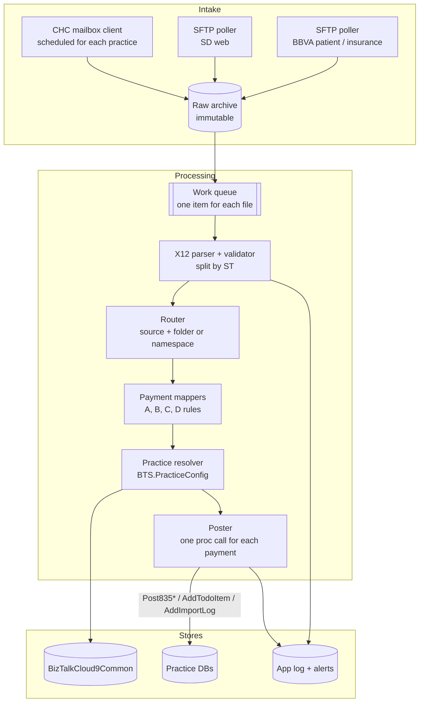

# Replacement guide: move the 835 payment flows out of BizTalk

This guide lists what an external application must do to replace flows A to E. It also lists the facts that you must confirm first, and a cut-over and test plan. Read [02-payments-835-end-to-end.md](02-payments-835-end-to-end.md) for the behavior and [04-data-contracts.md](04-data-contracts.md) for the interfaces.

## 0. Project context (discovery session, 2026-10-14)

Source: `references/BizTalk to Cloud9 Discovery 20261014-171226UTC.docx`.

- **Initiative.** "EDI Replacement for BizTalk" is an approved initiative (development forecast line 58).
- **Partners.** The work is part of the Fifth Third payment-file work. Guidehouse can still be in the transfer path. The ISA sender `BBVANAV` is most likely BBVA plus Navigant, and Guidehouse bought Navigant **(inferred)**. The release notes use "BBVA" and "Guidehouse" for the same 835 fixes.
- **First scope.** Flows A and C (BBVA / Fifth Third patient and insurance lockbox). Confirm that flow B (SD web) uses the same transfer and posting parts. The code shows that it does. Flow B has its own SFTP folders and its own posting map.
- **Out of scope.** The 271 eligibility flows and the patient insurance policy updates are inactive. Do not migrate them unless code and production evidence show that a live flow uses them.
- **Not named.** The discovery document does not name flow D (Change Healthcare ERA) or flow E (pass-through). Confirm if they are live. The discovery asks for a design that can take more 835 types later, for example ERA adjustments. It does not say that BizTalk supports them today.
- **Identity.** The BizTalk host runs as `c9\svc.biztalk.host`. It most likely uses integrated security to reach the databases.
- **People.** Wes Valure and Cade Roux review the source. Wes builds the active-flow inventory. Taylor Paddock answers questions about the legacy setup. Jonathan and the file-transfer stakeholders confirm the Fifth Third and ERA scope.

## 1. What BizTalk does today (responsibility list)

| #   | Responsibility                 | BizTalk part                                                                                                                         | Replacement must                                                                                                                         |
| --- | ------------------------------ | ------------------------------------------------------------------------------------------------------------------------------------ | ---------------------------------------------------------------------------------------------------------------------------------------- |
| R1  | Pull files from partner SFTP   | SFTP receive locations (BBVA, SD web, CHC). Poll 15 min (BBVA, SD) or 5 s (CHC). Daily window 02:00 to 05:00 Eastern for BBVA and SD | Poll each partner folder. Keep the region folder name with each file. Delete or move the remote file only after a safe local copy exists |
| R2  | Watch local or UNC folders     | FILE receive locations, poll 60 s, batch 20 files                                                                                    | Watch the same folders during a parallel run, or replace them with direct SFTP intake                                                    |
| R3  | Archive the raw file           | `Archive` pipeline component writes `<folder>\Archive\<file name>` and overwrites                                                    | Store the raw bytes before parsing. Use a unique name (the current component overwrites a file with the same name)                       |
| R4  | Parse and validate X12         | EDI disassembler, party agreements, `EdiDataValidation=true`                                                                         | Parse ISA/GS/ST envelopes. Validate the X12 syntax. Split by ST. Reject or quarantine a bad interchange                                  |
| R5  | Pick the flow                  | Receive port (patient or insurance folder), or message type and namespace (CHC)                                                      | Route by source and folder: patient lockbox, insurance lockbox, SD web, CHC ERA                                                          |
| R6  | Find the practice database     | Folder name or file prefix, then `BTS.GetPracticeConfigurationByName`                                                                | Same lookup. Fail loudly when no row matches (BizTalk does not)                                                                          |
| R7  | Transform each payment         | Maps described in document 02                                                                                                        | Implement the field rules in code. Use the map summaries as the specification                                                            |
| R8  | Post each payment              | Practice `BTS.Post835PatientTransaction` or `BTS.Post835InsuranceTransaction`, one call for each payment, no shared transaction      | Call the same procedures with the same parameters. Keep one call for each payment unless you change the procedures                       |
| R9  | Reversals (CHC)                | `BTS.AddTodoItem` instead of a post                                                                                                  | Same rule and same message text                                                                                                          |
| R10 | Import log                     | `BTS.AddImportLog` once for each payment                                                                                             | Same rows, same `ilProcess` values, so that the Cloud9 screens keep working                                                              |
| R11 | Error log                      | Windows event log, BizTalk suspended instances, central `BTS.Log`                                                                    | Structured logs, alerts, a dead-letter folder, and `BTS.Log` rows if other teams read them                                               |
| R12 | Download from the CHC mailbox  | Controller and worker orchestrations, `BTS.ProcessParameter` trigger, HTTP XML API, base64 and PKZIP decode                          | Run on a schedule for each practice. Call the same API. Decode the payload. Delete the mailbox file only after a safe local copy         |
| R13 | CHC 835 pass-through (if live) | Look up agreement by payee ID, re-envelope, SFTP to SD/BBVA                                                                          | Confirm if this flow is live (state `Unenlisted` in one binding). If yes, re-envelope with the BBVA ISA/GS IDs and send                  |
| R14 | TA1 acknowledgments            | `SP_ACKS` writes TA1 messages to `${ADDR_FILE_ROOT}\Acks`                                                                            | Decide if you need acknowledgments. BizTalk does not send them back to the partners from these bindings                                  |
| R15 | Monitoring                     | None. Operators read the event log and the BizTalk console. An SFTP adapter that stops leaves files on the server with no alert      | Send transport, parse, validation, database, and business-rule events to Datadog. Alert when a file stays unprocessed too long           |
| R16 | Recovery and replay            | Manual: restart the host, restore the file from the archive, reprocess by hand                                                       | Give operators a safe replay with duplicate protection, a clear retry policy, and an audit trail                                         |

### Requirements from the discovery session

The discovery document adds these requirements. Each one maps to a responsibility above.

| Requirement                                                                                                  | Maps to  |
| ------------------------------------------------------------------------------------------------------------ | -------- |
| Process each eligible file exactly once                                                                      | R1, R16  |
| Support polling or event-driven pickup. Check that a file is stable (not still in upload) before you read it | R1       |
| Keep the business routing of the legacy folders and the Cloud9-instance mappings                             | R5, R6   |
| Archive successful files. Quarantine failed files. Give each file an immutable correlation ID                | R3, R11  |
| Reproduce all active validation, numeric conversion, mapping, and transaction-type rules                     | R4, R7   |
| Call the Cloud9 transaction-post procedure and write the expected import-log row                             | R8, R10  |
| Make the transaction-type handling extensible (ERA adjustments and other 835 content)                        | R7       |
| Send telemetry to Datadog with actionable alerts                                                             | R11, R15 |
| Use managed credentials or workload identity where possible. Document any integrated-security dependency     | R6, R8   |
| Show the status of each file and each transaction: source, times, destination instance, result, error        | R10, R11 |

An earlier vendor note (`references/SFTP Monitoring Tool.docx`) shows that the SFTP adapters stopped in the past and left files unread. It proposed BizTalk360 folder monitoring or a custom Windows service that emails watchers. R15 replaces both options.

## 2. Facts to confirm before you build

These facts are not in this repository, or the repository is not consistent. Each one can change the design.

1. **Live procedure signatures.** Read `BTS.Post835PatientTransaction`, `BTS.Post835InsuranceTransaction`, `BTS.AddImportLog`, `BTS.AddTodoItem` from one practice database. The insurance map writes to a `Transactions` table-valued parameter (`udt835Transaction`) that the repository schema does not have. Use the query in [04-data-contracts.md](04-data-contracts.md#read-the-live-procedure-signatures).
2. **Procedure behavior.** Read the procedure bodies. Find the duplicate check, the transaction type selection (`BTS.PaymentType`), the claim match, and the `UnmappedTransaction` path. BizTalk has no duplicate protection of its own.
3. **Deployed assemblies.** The deployed BizTalk DLLs can differ from this source. Export the maps from the server (or decompile `Cloud9.BizTalk.X12.dll`) and compare with the map summaries.
4. **Live receive location state.** The master binding has `Enable=false` on many locations and puts SFTP locations in a dev-only block. Export the live bindings from BizTalk Administration and compare.
5. **PracticeConfig names.** List `pcName` values. Every region folder (and every `SD-<REGION>` folder) needs a row. Run [GetPracticeConfig.sql](../../Cloud9.BizTalk.Scripts/IntegrationsCommon/GetPracticeConfig.sql).
6. **Party IDs.** Confirm the ISA06/ISA08 and GS02/GS03 values that each partner sends today. The agreements in [PartyCollection.xml](../../Cloud9.BizTalk/Configuration/PartyCollection.xml) are a 2020 export.
7. **CHC trigger.** Find the job that inserts `BTS.ProcessParameter` rows with `ppProcessName = 'ProcessCHCInboundFiles'`.
8. **Flow E status.** Confirm if `Process_CHC_835_To_BBVA` is enlisted on the production server.
9. **Who reads ImportLog and BTS.Log.** Confirm the Cloud9 screens and reports that depend on these rows and on the exact `ilProcess` values.
10. **Transfer endpoint.** Confirm which SFTP endpoint and owner the new application uses after the file-transfer changes. Confirm if Guidehouse stays in the path, and when Fifth Third becomes the direct source.
11. **File inventory.** For each active flow, list the file name patterns, folders, party IDs, arrival times, sizes, and record counts. The discovery reports about 9 active folders of 21. The binding has 22 regions.
12. **Schedule.** The master binding has a 02:00 to 05:00 Eastern window. The discovery reports polls every 15 minutes and a peak near 06:00. Read the live receive location schedule.
13. **Acknowledgments.** The samples have ISA14 = `0`. Confirm with the partner that no 997, 999, or result file is necessary.
14. **EDI settings on the server.** Export the live party agreement and the validation settings. Release 1.3.2108.86 added settings for ISA11 `^` and for $0.00 amounts. The repository export ([PartyCollection.xml](../../Cloud9.BizTalk/Configuration/PartyCollection.xml)) is older.
15. **Database identity.** List the permissions of `c9\svc.biztalk.host` on `BizTalkCloud9Common` and on each practice database. The new identity needs the same `EXECUTE` rights.
16. **Failure rules.** Agree which errors are retryable, which go to quarantine, and when processing stops. Agree how to prevent duplicate postings on a retry.

## 3. Target design (suggested)



Design notes:

1. **Idempotency.** Store a hash of each raw file and each ST transaction set. Skip a set that is already done. BizTalk posts again if the same file arrives twice, unless the procedure rejects it.
2. **Unit of work.** BizTalk posts one payment at a time and continues after an `ErrorCount` failure. Keep this behavior at first, so that the Cloud9 data matches. Record the result of each payment so that a rerun can skip the posted ones.
3. **Practice resolution.** Make the folder-to-practice map explicit in configuration, or keep the lookup by `pcName`. Fail the file and alert if no practice matches.
4. **Configuration.** Move every `${...}` value to the new configuration store. Keep secrets in a vault. The settings file in this repository holds secrets in plain text (see document 05).
5. **Parsing library.** Use an X12 005010X221A1 parser that keeps the custom BBVA qualifiers (`REF*LB`, `REF*EJ`, `REF*69`). The SD web files use the same segments with non-standard REF qualifiers (`2H`, `1Z`, `TN`, `8X`, `EY`, `EM`, `TD`).
6. **Dates.** BizTalk sets `transDateTime` and `transDateTimePosted` to the processing time, not BPR16 or DTM02. Keep this unless the business asks for a change. The server time zone matters. The BizTalk server time is the current reference.
7. **Logging.** Keep `ilProcess` values the same (`Process_BBVA_835Patient`, `Process_SD_835Patient`, `Process_BBVA_835Insurance`, `Process_CHC_835Insurance`), or agree new values with the Cloud9 team.
8. **Identity.** Use a managed identity for the databases and a vault for the SFTP keys. Do not reuse the `c9\svc.biztalk.host` account.
9. **EDI tolerance.** Accept `^` in ISA11. Accept $0.00 in CLP04 and in service-line amounts. Do not reject a payment with an unknown `patGUID` or `pipGUID`. The procedure sends it to the unmapped transactions.
10. **Observability.** Give each file a correlation ID. Put the ID in every log line, Datadog event, and `ImportLog` row where a field exists.

## 4. Payment rules to implement (pseudo-code)

The code below restates the maps. The map summaries are the source of truth.

```text
for each file:
    archive(file)
    for each ST transaction set in file:
        source  = BBVA_PATIENT | BBVA_INSURANCE | SD_WEB | CHC
        pcName  = folderName(file)                        # BBVA, SD (keeps "SD-")
                | fileName.afterLast('\').before('_')     # CHC
        practice = GetPracticeConfigurationByName(pcName)  # central DB

        case BBVA_PATIENT:
            lockbox = REF*LB.REF02.replace(DTM02, "").trimOneTrailing("_")
            note    = "Deposit Date: {DTM02}, Check Date: {BPR16}, Lockbox: {lockbox}"
            for each CLP loop:
                p = Post835PatientTransaction(
                      transGUID=newGuid, transStatus="N", transIsGroup="0",
                      transProductionAmount=0, transClaimAmount="0",
                      transAmount=transDueNowAmount=transTotalDueAmount = -CLP04,
                      transDateTime=now, transDateTimePosted=now,
                      patGUID=NM1*QC.NM109, ppGUID=NM1*IL.NM109,
                      transRouting=BPR07, transReference=TRN02, transCheckNumber=TRN02,
                      lbcLockboxCode=BPR04, lbcLockboxCodeType="PATIENT",
                      PaymentIdentifier=REF*F8.REF02, transNote=note)
                AddImportLog(process="Process_BBVA_835Patient", ref=REF*F8.REF02, result=p)

        case SD_WEB:
            for each CLP loop:
                ref(q) = REF02 where REF01 == q inside the CLP loop
                type   = BPR04                      # CCC | ACH | REV
                note   = ACH: "{M/dd/yyyy} payment; Transaction ID = {ref(2H)}; Response = Check Submitted"
                         REV: "{M/dd/yyyy HH:mm:ss tt} - Web ACH Return - (${abs(CLP04):#.##}) Additional Info: {ref(2H)}"
                         CCC: "Approval Code={ref(1Z)}; Transaction ID={ref(2H)}"
                p = Post835PatientTransaction(
                      ...same constants and amounts as BBVA patient...,
                      patGUID=first NM1.NM109, ppGUID=NM1*IL.NM109,
                      lbcLockboxCode=type, lbcLockboxCodeType="WEB",
                      transApprovalCode=ref(1Z), transTransactionIDStr=ref(2H),
                      transCardNumber = type==CCC ? ref(TN) : null,
                      transCardType   = type==CCC ? ref(8X) : null,
                      transCheckNumber= type in (ACH,REV) ? ref(1Z) : null,
                      transRouting=ref(EY), xwebGUID=ref(EM),
                      transReference = len(ref(EY))>0 ? (type in (ACH,REV) ? ref(TN) : null) : (type==CCC ? ref(TN) : null),
                      transNote=note, transReceiptNote=note)
                AddImportLog(process="Process_SD_835Patient", message = ok ? "Processed successfully" : p.ResponseMessage)

        case BBVA_INSURANCE:
            clp = count(LX loops); plb = count(PLB)
            if not (clp == 1 or plb == 0):
                AddImportLog(Failed, "There were {clp} CLP payments and {plb} PLB adjustments on transaction {ST02}")
                continue
            base = "Deposit Date: {DTM02}, Check Date: {BPR16}, Claim Number: {CLP01}, Lockbox: {lockbox}"
            for each CLP loop:
                note = BPR04 == "NON"
                       ? left(base + ", " + casList(claim CAS) + ", " + casList(service CAS), 250)
                       : base                      # casList = "CAS02: CAS03" joined by ", " (first pair only)
                p = Post835InsuranceTransaction(
                      constants as above, amount = -CLP04,
                      patGUID=REF*EJ, pipGUID=REF*69, pipPolicyNumber=NM1*QC.NM109,
                      adaClaimNumber=CLP01, ptPaymentTypeCode=BPR04, transRouting=BPR07,
                      transCheckNumber=TRN02, transReference=TRN02, ClaimIdentifier=TRN04,
                      PaymentIdentifier=REF*F8, transNote=note, transReceiptNote=note)
                AddImportLog(process="Process_BBVA_835Insurance", ref=REF*F8, result=p)
            n = 0
            for each PLB:
                n += 1
                p = Post835InsuranceTransaction(
                      constants, amount = PLB04 (map negates twice),
                      AdjustmentType=PLB03-1, transReference="ADJ{n}-{TRN02}",
                      patient/policy/claim fields from the single CLP loop,
                      transNote = base + ", Adj Reason: {PLB03-1}")
                AddImportLog(process="Process_BBVA_835Insurance", message="ADJ - " + p.ResponseMessage)

        case CHC:
            for each CLP loop:
                claim = int(CLP01.substring(12))          # fail the set if this does not parse
                reversal = CLP04 < 0 or CLP02 == "22" or any(service CAS01 contains "CR")
                if reversal:
                    AddTodoItem(adaclaimNumber=claim, message="Payment for claim{claim} needs reversal for amount ${CLP04}.")
                elif practice is null:
                    BTS.Log("Connection String not found for Claim {claim} in File {file}")
                    continue                               # no ImportLog row
                else:
                    p = Post835InsuranceTransaction(
                          constants, amount=-CLP04, adaClaimNumber=claim,
                          pipPolicyNumber=NM1*QC.NM109, ptPaymentTypeCode=BPR04,
                          transRouting=BPR07, transCheckNumber=TRN02,
                          transNote = transReceiptNote = "Check Number: {TRN02}, Claim Number: {claim}")
                AddImportLog(process="Process_CHC_835Insurance", message = ok ? "Processed successfully" : error)
```

Rules for the edge cases:

1. **Comparisons.** The functoid names for `<`, `OR`, `Find`, `Left`, `Size`, `Subtraction`, `Multiplication` are inferred from their inputs. Confirm with a sample file and the BizTalk output before you rely on them.
2. **Multiple links to one field.** In the BBVA insurance map, `pipGUID` gets values from three links. Test with real files to see which value BizTalk sends.
3. **Missing segments.** BizTalk sends no element when the source segment is missing. The procedure then uses its default. Do the same: omit the parameter, do not send an empty string for a GUID.

## 5. Cut-over plan

1. **Read-only shadow run.** Run the new application on copies of the production files. Do not post. Compare each computed parameter set with the BizTalk tracking data (message body tracking is on for `Process_CHC_835Insurance` only). For the other flows, compare with the `[Transaction]` rows and `ImportLog` rows.
2. **Test database run.** Post to a test practice database. The discovery names Cloud9 T for this comparison. The settings also have an `SDLab1` environment. Use the test-file scripts in [Cloud9.BizTalk.Scripts](../../Cloud9.BizTalk.Scripts) to build files with real GUIDs. If necessary, restore the test BizTalk instance. Then run the same 835 files through BizTalk and the new application and compare the results.
3. **Switch one source at a time.** For each source and region:
   1. Disable the BizTalk receive locations for that source (FILE and SFTP).
   2. Enable the new poller for the same folders.
   3. Watch `ImportLog` and the alert channel for one full business cycle.
4. **Keep BizTalk for rollback.** Do not undeploy the orchestrations until every source runs on the new application for an agreed period.
5. **CHC last.** The CHC flow shares the `CHC_Inbound` folder with the 277 and 277CA flows. If the new application takes over the mailbox download, it must also feed the 277 files to BizTalk (or replace those flows too). Else the claim status flows stop.
6. **Retire with evidence.** Before you disable a legacy folder, port, or service, agree an observation period. Show zero traffic for that period.

The discovery document has an eight-step validation plan. The steps above and the tests below cover it:

| Discovery step             | Where in this guide                                   |
| -------------------------- | ----------------------------------------------------- |
| 1. Configuration inventory | Section 2, facts 3, 4, 11, 12, 14                     |
| 2. Code-path analysis      | Document 02 and section 4                             |
| 3. Golden-file comparison  | Cut-over steps 1 and 2                                |
| 4. Negative testing        | Test checklist                                        |
| 5. Volume and timing       | Not covered yet. Replay a peak morning and a full day |
| 6. Recovery and replay     | Design notes 1 and 2, test checklist                  |
| 7. Observability           | R15, design note 10                                   |
| 8. Cut-over rehearsal      | Cut-over steps 3 to 6                                 |

## 6. Test checklist

| Test                                                        | Expected result                                                                                                 |
| ----------------------------------------------------------- | --------------------------------------------------------------------------------------------------------------- |
| BBVA patient file, two CLP loops, valid GUIDs               | Two `[Transaction]` rows with negative amounts, `lbcLockboxCodeType = PATIENT`, two `ImportLog` rows `Finished` |
| BBVA patient file for a region with no `PracticeConfig` row | New application: file failed and alert. BizTalk today: event log only                                           |
| SD web CCC payment                                          | `transCardNumber`, `transCardType`, `transApprovalCode` set, note `Approval Code=...; Transaction ID=...`       |
| SD web ACH payment                                          | `transCheckNumber` = REF*1Z, `transReference` = masked bank account, note with `Check Submitted`                |
| SD web REV payment                                          | Note with `Web ACH Return` and the absolute amount                                                              |
| BBVA insurance, one CLP, one PLB                            | One claim row, one adjustment row with `ADJ1-<TRN02>`                                                           |
| BBVA insurance, two CLP, one PLB                            | Nothing posted, one `Failed` ImportLog row with the CLP/PLB count message                                       |
| BBVA insurance, BPR04 = `NON`                               | Note lists CAS reasons and amounts, max 250 characters                                                          |
| CHC 835, CLP02 = `22`                                       | `AddTodoItem` call, no post                                                                                     |
| CHC 835, CLP01 too short                                    | The transaction set fails with `ParseClaimNumber` error                                                         |
| Same file twice                                             | Decide and test the duplicate rule (BizTalk has none of its own)                                                |
| File with ISA11 = `^`                                       | Parsed and posted (release 1.3.2108.86, C9-34067)                                                               |
| CLP04 = 0.00                                                | Not rejected by the parser (C9-33835). Compare the procedure result with BizTalk                                |
| BBVA insurance with an unknown `patGUID`                    | Row in `UnmappedTransaction` (C9-33839)                                                                         |
| SFTP file not picked up within the agreed time              | Datadog alert                                                                                                   |
| Database not reachable during a file                        | File in quarantine or retry as agreed. A replay posts no duplicates                                             |
