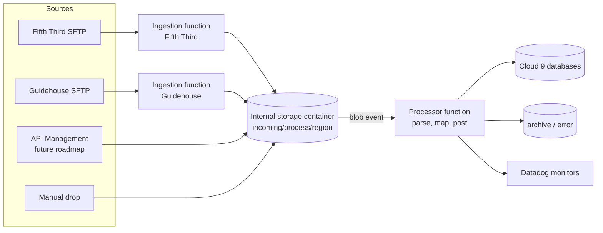

# BizTalk retirement roadmap (draft for review)

Status: draft, 2026-10-28. Owner: Wes Valure. Estimates are rough and are not commitments. Facts that are not yet confirmed are marked **(assumption)** or **(open)**.

## 1. Summary

> **IMPORTANT: retiring BizTalk will not end our dependence on Guidehouse.**
>
> - **What changes:** insurance payment files currently reach Guidehouse through a manual transfer from Fifth Third bank. Once we collect them directly from Fifth Third, they no longer need to pass through Guidehouse.
> - **What does not change:** other processes, such as patient payments, are still delivered to the Guidehouse SFTP. We must keep collecting and monitoring those, so our connection to Guidehouse stays.
> - **What it means:** the Guidehouse relationship and any associated costs will continue after this project. Those other files, and the processes behind them, are outside this project's scope.

- **Goal.** Replace the BizTalk file flows that post payments to Cloud 9, then retire BizTalk. First scope: the Fifth Third / BBVA patient and insurance lockbox flows. The web patient payment flow is not part of this project, because it has already been wound down.
- **Where we are.** The **patient** and **insurance** proofs of concept are both complete. Each reads its 835 files and posts to C9-T. The patient proof of concept was also compared with production data. What remains is to move both into the Azure processor, set up the Azure environment, and complete the partner, network, and parallel-run work below.
- **Approach.** Separate external transport from internal processing. Partner sources drop files into one internal storage container. API Management is a future route into the same container. One processor, triggered by the container, posts to Cloud 9. A new partner source, or a change of partner, adds or removes a source function and does not change or redeploy the processor.
- **Estimated retirement window.** About 6 to 10 weeks from 2026-10-28, which is roughly **2026-12-09 to 2027-01-06 (assumption)**. Build effort is about 45 hours (roughly 1.5 weeks of work), reusing the completed patient and insurance proofs of concept. The calendar time comes from Engineering, partner allowlisting and testing, and the parallel-run observation period, not from build effort. A year-end change freeze, if one applies, would move the end later **(open)**.
- **Critical path.** Engineering (network and static outbound IP), then partner IP allowlisting, then partner testing, then the parallel run.

## 2. Architecture decision

- **Landing zone.** One container. Layout: `incoming/<process>/<region>/<file>`, for example `incoming/835PatientPayment/<region>/`. The process folder selects the flow, and the region folder selects the practice, as BizTalk does today. The source name is kept as blob metadata. A region-to-practice mapping table is a later backlog item (for example, a renamed region).
- **Ingestion.** One function per external SFTP source. Each function only copies files into the container. Each is built later, so the core can be built and tested first by dropping sample files.
- **API Management (future roadmap).** API Management can later drop incoming API files into the same container, and it remains a route for other uses. It is not part of this project's scope or estimate.
- **Processor.** One blob-triggered function. It parses and validates the file, maps each payment, posts to Cloud 9, writes the import log, and moves the file to processed or error.
- **Pickup access.** Do not assume write access on partner SFTP. The pollers read only. Whether pickup credentials may move or delete files is a partner question.

### Hosting plan

- **Working decision: Flex Consumption plan with VNet integration (assumption, pending Engineering).** Reasons: it keeps pay-per-use cost, and unlike the classic Consumption plan it supports VNet integration. The VNet is needed to reach the Cloud 9 databases and to give partners a stable source IP. The App Service plan used by other apps is being avoided.
- Constraints from Microsoft's documentation: Linux only (no Windows integrated security), .NET 8 to 10 isolated worker, the blob trigger uses Event Grid only, one app per plan, and no deployment slots. The VNet subnet must be delegated to `Microsoft.App/environments`.
- A static outbound IP needs a NAT gateway on the integration subnet. The design is **not confirmed** for Flex Consumption and Engineering must confirm it. Engineering has no NAT gateway or static outbound IP today, and the cost is being clarified.
- Only PROD needs the static IP, because partners allowlist the production source. DEV does not need a NAT gateway unless a partner test SFTP also requires allowlisting.

### Environments and deployment

- Two environments: DEV (posts to C9-T) and PROD (posts to C9-P).
- Build DEV by hand and record each setting so it can be rebuilt. Capturing DEV and PROD as local Terraform is optional and not in scope yet. If it is added later, Terraform state is local at first, and moving it to a storage account is a later option.
- Resources go in the app-dev specific Azure subscription (decided). That subscription needs the `Microsoft.App` resource provider registered before VNet integration works.

### Security and credentials

- Partner SFTP passwords move from LastPass to Key Vault. The function reads them with a managed identity. Pin the SFTP host keys: store each partner's expected server fingerprint and refuse to connect if the server presents a different one. BizTalk does not check this today, so it cannot tell a real partner server from an impostor. Pinning closes that gap, but each partner must give us its fingerprint and tell us when it changes. 
- Cloud 9 SQL uses a SQL login stored in Key Vault. Investigate managed identity for SQL again later.
- Credential contact: Jon Morgan, Sr VP RCM (Smile Doctors) and Current Product Owner. Ownership of each partner credential and the rotation process are open.

### File handling rules

- **File level.** Same name and content as a processed file: skip. Same name with different content: flag for a person (possible correction). A file in error: can be replayed.
- **Payment level.** The Cloud 9 ledger decides. A payment already in the ledger is never posted again. A half-posted file can be replayed to catch the missing payments.
- **Open.** Replay depends on the payment-level duplicate check in each posting procedure. The patient and insurance procedures are known from the proofs of concept. The patient check also blocks previously failed payments. In plain terms: the patient procedure rejects any payment whose payment identifier already appears in the import log, including entries marked as failed. A payment that failed once therefore cannot be retried with the same identifier after the data is fixed, unless the import log entry is reset or the procedure is changed. This was seen on the test server and still needs confirming in production.

### Monitoring

- Datadog monitors for: a file stuck in the container or in error past a threshold, a source that delivered nothing in its expected window, and repeated function failures. Thresholds depend on the real arrival patterns. Notification owners are open.

## 3. Work chunks and estimates

Effort is in working hours (AI estimate). Calendar time includes waiting.

| #   | Chunk                                                                                       | Effort | Calendar                       | Depends on                                           |
| --- | ------------------------------------------------------------------------------------------- | ------ | ------------------------------ | ---------------------------------------------------- |
| 1   | Engineering requests: static outbound IP and cost, `Microsoft.App`, VNet to Cloud 9 SQL     | 2h     | Unknown (largest unknown)      | Engineering                                          |
| 2   | Manual DEV build: storage, drop container, Event Grid, function app, Key Vault, App Insights | 1 day (about 6h) | 1 day                | Chunk 1 for the VNet and SQL parts                   |
| 3   | Core processor in DEV: port the completed insurance proof of concept to a blob trigger (insurance folder routing), add file status and replay, with tests | 4-6h   | 1-2 days                       | Chunk 2 for the Azure parts. Posting from Azure needs the VNet to Cloud 9 SQL |
| 3b  | Port the completed patient proof of concept to the processor (patient folder routing, tests) | 2-3h   | 1 day                          | Chunk 3                                              |
| 4   | Datadog monitors and alerts                                                                 | 4h     | 1 day                          | Notification owners                                  |
| 5   | Terraform for DEV and PROD (optional, not in scope yet; not in the total)                   | (4-6h) | (1-2 days)                     | Chunks 2 to 4 settled                                |
| 6   | PROD build with NAT gateway                                                                 | 3-4h   | 1 day                          | Engineering cost approval                            |
| 6a  | Partner IP allowlisting (can be kicked off in parallel with chunks 2 to 4, pending chunk 1) | 1-2h   | Days to weeks                  | Static IP from chunk 1. Fifth Third and Guidehouse   |
| 7   | Vendor ingestion functions (Fifth Third, Guidehouse), parallel                              | About 4h each | Driven by partners      | Chunk 6a, credentials, partner test files            |
| 8   | Parallel run and validation per flow                                                        | About 10h | Observation period (open)   | Chunks 3 to 7                                        |
| 9   | Cutover and disable BizTalk locations                                                       | About 4h | After the observation period | Chunk 8 and acceptance criteria                      |
| -   | **Total** (excludes the optional chunk 5)                                                   | **About 45h** | **6-10 weeks (assumption)** |                                                      |

Sequencing rules:

- Chunks 2 and 3 do not wait for partners. Build and test with sample files.
- Partner allowlisting (6a) starts in parallel with chunks 2 to 4, as soon as chunk 1 gives us an IP.
- Fifth Third and Guidehouse ingestion are independent and run in parallel.
- The Guidehouse ingestion function cannot be disabled when the insurance carriers move to Fifth Third, because other patient payment files still arrive on the Guidehouse SFTP. Both ingestion functions stay in service. Disabling Guidehouse needs a separate investigation of those files, which is out of scope here. The processor does not change either way.
- Both proofs of concept are complete. The insurance port comes first, and the patient port follows it closely.

## 4. Near-term milestones

| Date           | Milestone                                                                                          |
| -------------- | -------------------------------------------------------------------------------------------------- |
| 2026-10-30     | This roadmap delivered, with blockers, dependencies, and the timeframe                              |
| 2026-11-06     | All external requests submitted. Insurance and patient files processed in DEV (against C9-T), or locally if the VNet is not ready |

The full retirement is not planned for 2026-11-06. See section 1.

## 5. External dependencies and blockers

| Item                                                                 | Owner                    | Needed for  | Status |
| -------------------------------------------------------------------- | ------------------------ | ----------- | ------ |
| Static outbound IP (NAT gateway) and its cost                         | Engineering              | PROD, 6a    | Message sent 2026-10-28. No NAT gateway exists today |
| `Microsoft.App` resource provider registered in the app-dev subscription | Engineering           | VNet integration | To request |
| App-dev VNet connectivity to the Cloud 9 SQL servers                  | Engineering              | Posting from Azure | To request. Largest technical unknown |
| Subscription move timing                                              | Engineering              | All Azure work | Moving to the app-dev subscription is decided. Timing open |
| Partner IP allowlisting and turnaround                                | Fifth Third, Guidehouse  | Chunk 7     | Needs the static IP first |
| Partner test environment or test files                                | Fifth Third, Guidehouse  | Partner testing | Open |
| Credentials for each partner and a rotation process                   | Jon Morgan, partners     | Chunk 7     | Credentials shared in LastPass today |
| Posting API alignment (#27684, #27685)                                | Cade Roux                | Chunk 3     | Open |
| Access to the live BizTalk configuration                              | Taylor Paddock           | Inventory, chunk 8 | Open |

## 6. Partner questions for Cade to escalate

Ask both Fifth Third and Guidehouse unless noted.

1. Which SFTP host, folders, and file name patterns will we pick up from? When do the insurance carriers move to Fifth Third as the direct source?
2. What is the access model (do we pull, or do they push)? Which credentials do we get, who owns them, and how are they rotated?
3. Do the pickup credentials allow moving or deleting files, or are they read-only? We will not assume write access.
4. Do you require our source IP addresses allowlisted? What is your turnaround for adding or changing one?
5. Is there a test SFTP environment or a set of test files? Who is the technical contact?
6. What is the actual delivery schedule (days, times, peak)? What happens on a holiday or a late file?
7. What happens when a file is re-sent with the same name? Can a re-sent file be a correction?
8. Do you expect any acknowledgment (such as 997 or 999) for received files?
9. (Jon Morgan, Product Owner) Which ERA transaction types, if any, are in scope, and who asked for them?
10. (Jon Morgan, Product Owner) What observation period and evidence do you require before a BizTalk folder or port is disabled?
11. (Guidehouse) Besides the insurance files, which other patient payment files arrive on the Guidehouse SFTP, in what format and volume, and what would it take to stop depending on Guidehouse for them?

## 7. Testing, monitoring, and retirement acceptance

**Automated tests**

- Scenario tests for each posting rule, built from the proof-of-concept scenarios (7 sample payments, 8 scenarios, with a comparison to production data). Ten error-path scenarios are not yet tested (backlog story #28101).
- Regression suite that runs on every change and finishes in seconds.
- A replay test: re-drop a file and confirm no duplicate posting.
- Production sample files and rows hold PHI. Test data must not contain production identities.

**Partner testing.** A test file from each partner through the real ingestion path, in DEV, before PROD.

**Retirement acceptance (per flow)**

1. The new path posts the same ledger data as BizTalk for the agreed columns, with every difference explained, over the agreed observation period (proposal: 2 weeks or one month-end cycle, to be agreed).
2. Replay, duplicate, and error handling are tested and documented in a runbook.
3. Datadog monitors are live, tested with a deliberately stuck file, and have named owners.
4. Partner credentials are in Key Vault, with owners and a rotation process recorded.
5. Partner allowlists and host keys are in place for PROD.
6. The BizTalk receive location shows zero traffic for the agreed period, and a rollback plan exists.
7. Sign-off from the business contact.

## 8. Risks

| Risk                                                                                         | Effect                                      | Mitigation                                                       |
| -------------------------------------------------------------------------------------------- | ------------------------------------------- | ---------------------------------------------------------------- |
| No static outbound IP or NAT gateway exists, and cost is unknown                              | Partners cannot allowlist us; schedule slips | Ask Engineering now. Only PROD needs the IP                      |
| App-dev subscription cannot reach the Cloud 9 SQL servers                                    | Processor cannot post from Azure             | Confirm early. Fallback: run the processor locally against C9-T  |
| Partner allowlisting and testing turnaround                                                  | Chunk 7 and the retirement date slip        | Escalate through Cade now                                        |
| Replay and duplicate rules depend on the posting procedures (patient check blocks failed payments) | Wrong or duplicate postings     | Verify before replay is enabled for each flow                    |
| Other patient payment files on the Guidehouse SFTP are not scoped                              | Guidehouse intake and cost continue after the insurance migration | Keep ingesting them. Investigate them separately |
| Subscription move changes resource IDs, network, or access                                    | Rework                                      | Build in the app-dev subscription directly; record each setting so it can be rebuilt |
| BizTalk has stopped silently before (2021, no alert)                                          | Missed payments during the parallel run     | Monitors for stuck files and missing deliveries from the start   |
| Active-flow inventory is incomplete (21 legacy folders, about 9 in use)                       | A live flow is missed at retirement         | Complete the inventory and the zero-traffic check before disabling BizTalk |
| Year-end change freeze or holidays                                                           | Window moves later                          | Ask Engineering about freeze dates                               |

## 9. Decisions requested

1. Approve the architecture: separate ingestion functions, one internal container, one processor.
2. Approve Flex Consumption with VNet integration as the working hosting plan, and a NAT gateway for PROD if Engineering cost is acceptable.
3. Agree the parallel-run observation period.
4. Approve escalating the partner questions in section 6.
5. Agree who investigates the other patient payment files on the Guidehouse SFTP, and when.

## 10. Out of scope and parked

- The web patient payment flow (already wound down), other 835 flows (CHC ERA, pass-through) unless live evidence shows they are used, and the inactive 271 flows.
- API Management as a route into the container (future roadmap).
- Investigation of the other patient payment files on the Guidehouse SFTP, and whether the Guidehouse relationship can end.
- Region-to-practice mapping table (backlog).
- Managed identity for Cloud 9 SQL (revisit later).
- Terraform for DEV and PROD (optional, not in scope yet), including moving Terraform state to a storage account.
- Whether a tracking table replaces blob tags for file status.
- Datadog integration method and alert thresholds.
